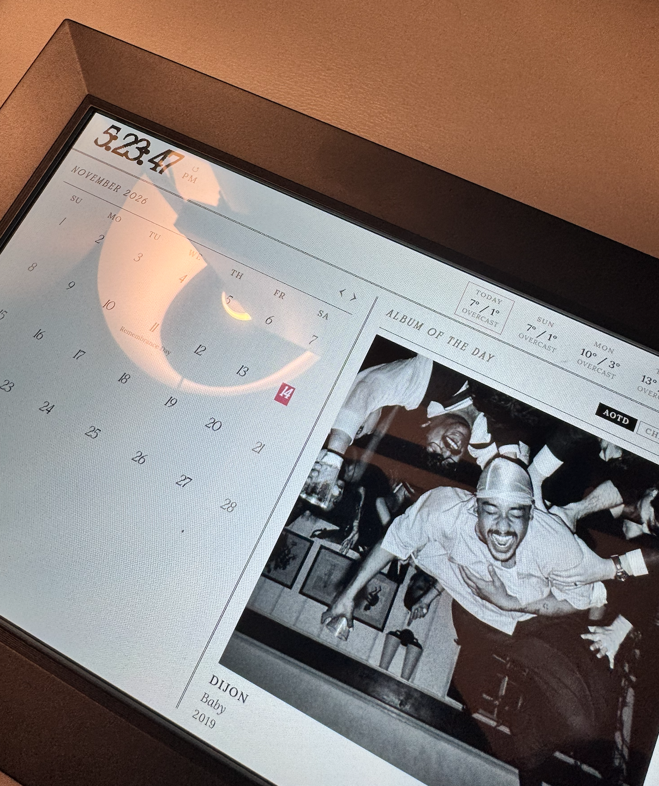
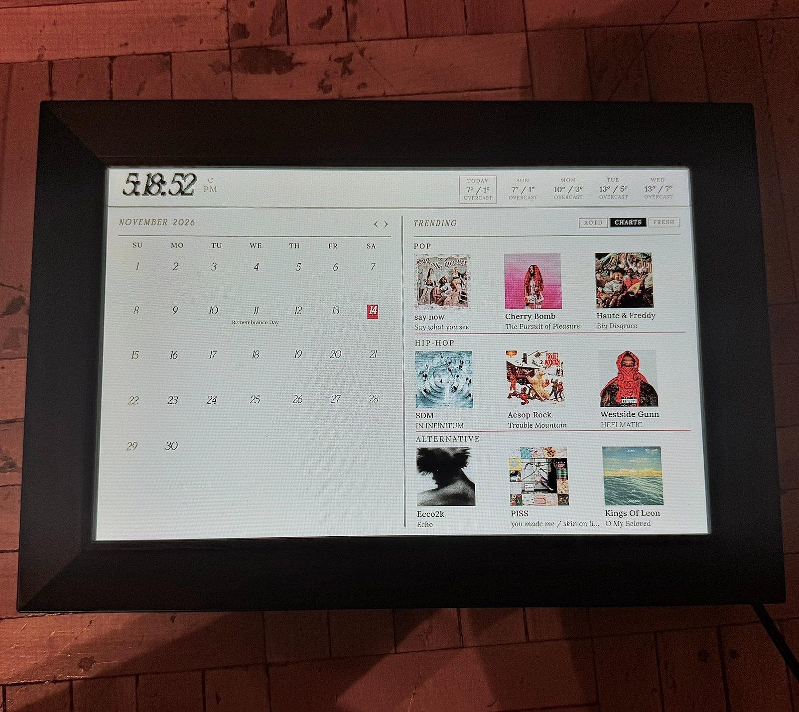

# Bulletin

A minimal newspaper-style dashboard for a digital photo frame or any Android display. Deployed on Vercel, served via a kiosk app from [wesbos/photo-frame-dashboard](https://github.com/wesbos/photo-frame-dashboard).

**Live:** https://bulletin-six.vercel.app




## Features

- **Clock** - live 12-hour clock with seconds
- **Weather** - 5-day forecast via Open-Meteo (no API key)
- **Music** - three-mode toggle: AOTD (album of the day from a curated list, rotates daily), Trending (Deezer charts), and Fresh (MusicBrainz new releases)
- **Calendar** - monthly calendar with Canadian holidays; click month label to jump to today
- **Auto theme** - light/dark based on time of day (7am/7pm EST)
- **Inactivity dim** - screen fades to black after 5 minutes of no touch; tap to restore

## Deploy

```bash
vercel --prod
```

`vercel dev` serves API routes locally on port 3000.

## Environment variables

| Variable | Description |
|---|---|
| `CALENDAR_URLS` | Comma-separated `.ics` feed URLs for upcoming events |

## Frame setup

Tested on a Rockchip RK3326 frame, Android 11, 1280x800.

### Requirements

```bash
brew install android-platform-tools
brew install --cask temurin android-commandlinetools
sdkmanager --sdk_root=/opt/homebrew/share/android-commandlinetools \
  "build-tools;36.0.0" "platforms;android-34"
```

> Use build-tools 36+ -- build-tools 34's `d8` crashes with JDK 17+.

### Build and install

```bash
git clone --depth=1 https://github.com/wesbos/photo-frame-dashboard.git
cd photo-frame-dashboard/dashboard/kiosk

sed -i '' 's|DEFAULT_URL = ".*"|DEFAULT_URL = "https://bulletin-six.vercel.app"|' \
  src/com/wesbos/homehq/MainActivity.java

ANDROID_HOME=/opt/homebrew/share/android-commandlinetools \
BUILD_TOOLS=/opt/homebrew/share/android-commandlinetools/build-tools/36.0.0 \
bash build.sh

adb install -r build/homehq.apk
adb shell am start -n com.wesbos.homehq/.MainActivity
```

### Set as home app (auto-starts on reboot)

```bash
adb shell am start -n com.wesbos.homehq/.MainActivity --ez home true
adb shell cmd package set-home-activity com.wesbos.homehq/.Home
adb shell settings put global stay_on_while_plugged_in 3
```

Hold two fingers still for 1.5s on the frame to open the kiosk menu.
